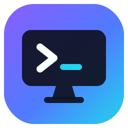
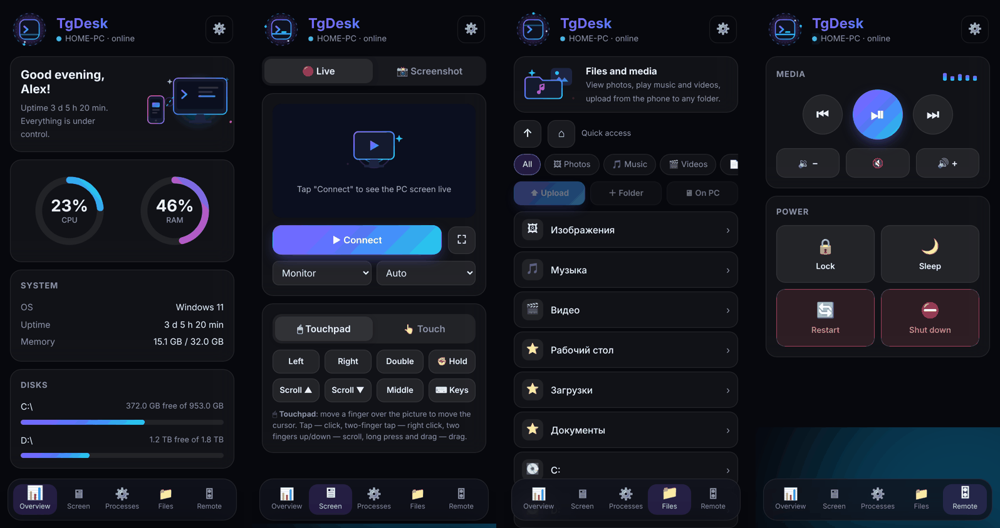

<p align="center">
  
</p>

<h1 align="center">TgDesk</h1>

<p align="center">
  <b>Control your Windows PC right from Telegram</b><br>
  <sub>Live screen · mouse & keyboard · files · clipboard · sound · power</sub>
</p>

<p align="center">
  <a href="https://github.com/k1llerov/tgdesk/releases/latest"></a>&nbsp;
  <a href="https://github.com/k1llerov/tgdesk/actions/workflows/build.yml"></a>&nbsp;
  <a href="LICENSE"></a>&nbsp;
  <a href="README.md"></a>
</p>

<br>

<p align="center">
  
</p>

<br>

TgDesk is **your own Telegram bot** and Mini App, running entirely on your computer. Everything stays on your PC — the bot, the web server and the access log. The only external services are Telegram itself and the Cloudflare tunnel.

---

## Features

<table>
<tr>
<td width="50%">

### 🖥 Live Screen
Watch your PC screen on your phone in real time. Touchpad or direct-touch mode, pinch to zoom, fullscreen. Quality adapts to your network speed automatically.

### 🖱 Mouse & Keyboard
Clicks, scrolling, drag and drop, text input in any language, Ctrl/Alt/Win and hotkeys — just like sitting at your desk.

### 📋 Clipboard
Send text from your phone to the PC clipboard and back. Use the Remote tab or the `/clip` command. Only the text length is logged, never the content.

</td>
<td width="50%">

### 📁 Files
Quick access to all drives. View photos, play music and video right in the app. Upload from your phone to any folder (chunked, resumable). Send files to the chat.

### ⚙️ Processes
Heaviest processes on top. Kill with one tap.

### 🎛 Remote Control
Volume and media keys, lock, sleep, restart, shut down — dangerous actions require confirmation.

</td>
</tr>
</table>

### And more

- 🤖 **Bot commands** — status, screenshot, processes, media, power — without opening the Mini App. Photos, videos and music you send are sorted into folders on the PC.
- 👥 **Multiple users** with separate permissions: screen-only for some, full access for others.
- 🖥 **Desktop app** — setup wizard, who is watching the screen right now (with a "Disconnect" button), access log, user management, feature toggles, tray icon.
- 🌐 **Russian and English** — everywhere: app, bot and Mini App.
- 🔄 **Auto-update** — new versions install automatically (never during a stream). Only releases **signed with the author's key** (ECDSA P-256) are accepted — a tampered release won't install. Can be turned off in settings.

---

## 🛡 Security & Fair Use

TgDesk is designed for controlling **your own** computer (or one whose owner knows and agrees). Some protections **cannot be disabled**:

| | Protection | Description |
|---|---|---|
| 🔴 | **Streaming badge** | Always visible on the PC while anyone watches the screen. Cannot be hidden. |
| 👁 | **Access log** | Every action is recorded: who, when, IP, device. |
| 🔐 | **Added users only** | The bot ignores strangers. Users can only be added from the PC: single-use code, 5 minutes, burns after 5 wrong attempts. |
| ✍️ | **Telegram signature** | Every Mini App request is verified. 8 failures from one IP — blocked for 15 minutes. |
| 🗝 | **Encrypted token** | The bot token is encrypted with Windows DPAPI — only your Windows user can read it. |
| 🧱 | **Localhost only** | The log and control API are reachable only from `127.0.0.1`. |

> More details in [SECURITY.md](SECURITY.md).

---

## 🚀 Installation (5 minutes)

### 1. Download & Install

Download **[TgDesk-Setup-x.y.z.exe](https://github.com/k1llerov/tgdesk/releases/latest)** from the Releases page. Everything is bundled (including .NET). **No administrator rights needed.**

> [!NOTE]
> The installer is not code-signed — Windows SmartScreen may warn you.
> Click "More info" → "Run anyway".
> Checksums are in `SHA256SUMS.txt` next to the installer.

### 2. Create Your Bot

The setup wizard opens. Click **"Open @BotFather"**, send `/newbot`, pick a name and a username for the bot.

### 3. Paste the Token

Copy the token BotFather sends you and paste it into the wizard → **"Check and save"**.

### 4. Pair Yourself

A **pairing code** appears on screen. Click "Open in Telegram" or send the bot `/pair 123456` — this makes you the owner.

### 5. Done!

Choose which features to enable. The chat with the bot now has a **TgDesk** button that opens the control panel.

> [!IMPORTANT]
> The computer must stay on and awake:
> *Settings → System → Power → Sleep → "Never"*.

---

## 👥 Users & Permissions

In the desktop app, open **Users → Add a user**:

1. Choose **"Full access"** or individual features:
   - 🖥 Screen
   - 🖱 Mouse & keyboard
   - 📁 Files
   - ⚙️ Processes
   - 🔊 Sound & media
   - 🔌 Power

2. Click **"Create code"**.
3. The person opens the link or sends `/pair <code>` to the bot.

Permissions can be changed or revoked at any time — that user's active streams are disconnected immediately.

> On the **Features** page you can disable a feature entirely — then nobody can use it, not even owners.

---

## 🌐 Mini App Address

Telegram requires HTTPS for Mini Apps, so TgDesk runs a tunnel.

| Mode | Requirements | Notes |
|:---|:---|:---|
| **Quick Tunnel** *(default)* | Nothing | Free, no account. Address changes on restart — the bot updates its button automatically. `cloudflared` is downloaded from Cloudflare's GitHub with SHA-256 verification. |
| **Cloudflare Tunnel** | Cloudflare account + domain | Permanent address. Create a tunnel in Zero Trust → Networks → Tunnels, route to `http://127.0.0.1:8765`, paste the token and address. |
| **Own address** | Your own HTTPS proxy | Any HTTPS address you route to `http://127.0.0.1:8765` on this PC. |

---

## 🗂 File Layout

```
📦 %LOCALAPPDATA%\Programs\TgDesk\         ← program files
│  ├── TgDesk.exe                           ← desktop app
│  ├── bot\TgDeskBot.exe                    ← bot and web server
│  ├── webapp\                              ← Mini App (HTML/JS)
│  └── Uninstall TgDesk.exe                 ← uninstaller
│
📂 %APPDATA%\TgDesk\                        ← user data
│  ├── config.json                          ← settings (tokens DPAPI-encrypted)
│  ├── users.json                           ← users and permissions
│  ├── access_log.jsonl                     ← access log
│  ├── tgdesk.log                           ← technical log
│  └── bin\cloudflared.exe                  ← tunnel (downloaded on first start)
│
🖼 Pictures\TgDesk\                         ← photos sent to the bot
🎵 Music\TgDesk\                            ← music
🎬 Videos\TgDesk\                           ← videos
📥 Downloads\TgDesk\                        ← other files
```

**Portable mode**: unzip `TgDesk-x.y.z-portable.zip` — the `portable.txt` file next to `TgDesk.exe` makes it keep all data in the `data` folder beside it.

**Uninstalling**: via Settings → Apps, from About → Uninstall TgDesk, or by running `Uninstall TgDesk.exe`.
Silent mode: `/S`, with data removal: `/S /purge`.

---

## 🏗 How It Works

```
                      ┌─────────────────────────────────────────────────────────┐
                      │                   Your PC (Windows)                     │
                      │                                                         │
 📱 Telegram ═══HTTPS═══► Cloudflare ──► :8765  TgDeskBot.exe  (C# / .NET 10)  │
                      │       Tunnel       │  ├─ Telegram bot (long polling)     │
                      │                    │  ├─ Mini App + streaming WebSocket  │
                      │                    │  ├─ :8766  access log (localhost)   │
                      │                    │  └─ :8767  control API (localhost   │
                      │                    │             + control.token)        │
                      │                    │                 ▲                   │
                      │                    │    TgDesk.exe  (C++ / Win32 + GDI+)│
                      │                    │    window · tray · setup wizard    │
                      └────────────────────┴────────────────────────────────────┘
```

| Folder | Description |
|:---|:---|
| `bot/` | Bot, web server, screen capture, input, tunnel (C# / ASP.NET Core) |
| `app/` | Dependency-free desktop app, ~1 MB (C++17, Win32, GDI+) |
| `webapp/` | Mini App and access log page (plain HTML/JS, no build step) |
| `installer/` | Custom installer & uninstaller (C++, GDI+, LZMS compression) + packer |
| `scripts/` | Build and translation scripts |
| `tests/` | Tests |

---

## 🔨 Building from Source

**Requirements:**
- [.NET 10 SDK](https://dotnet.microsoft.com/) (system-wide or local in `.tools\dotnet`)
- [MinGW-w64 g++](https://winlibs.com/) (`winget install BrechtSanders.WinLibs.POSIX.UCRT`)
- [Python 3](https://python.org/)

```powershell
git clone https://github.com/k1llerov/tgdesk
cd tgdesk
```

```powershell
dotnet test tests/TgDesk.Tests/TgDesk.Tests.csproj
```

```powershell
.\scripts\build.ps1 -Installer -Portable
```

Output is in `dist\`. Every `v*` tag is built by GitHub Actions and published as a draft release with `SHA256SUMS.txt`.

---

## 🌍 Translations

Texts are written in Russian in the code; English translations live in `i18n/*.en.json`. After changing texts:

```powershell
python scripts/i18n.py
```

See [docs/TRANSLATING.md](docs/TRANSLATING.md) for details.

---

## ❓ FAQ

<details>
<summary><b>The bot doesn't connect</b></summary>

If Telegram is blocked in your network, the PC needs a VPN. Check the Overview page for status and Log → Technical log for details.
</details>

<details>
<summary><b>"409 Conflict" in the technical log</b></summary>

Another program is using this token. Each PC needs its own bot.
</details>

<details>
<summary><b>Input doesn't work in some windows</b></summary>

Windows doesn't allow controlling windows running as administrator or the lock screen.
</details>

<details>
<summary><b>No TgDesk button in the chat</b></summary>

Send the bot `/start` — it replies with an "Open TgDesk" button.
</details>

<details>
<summary><b>Windows SmartScreen blocks the installer</b></summary>

The installer is not code-signed. Click "More info" → "Run anyway". Verify the checksum in `SHA256SUMS.txt`.
</details>

---

## 📄 License & Author

Author — **k1llerov™**

License — [MIT](LICENSE). Use it fairly: only on your own computers or with their owners' consent.

---

<p align="center">
  <sub>Made with ❤️ by <b>k1llerov™</b></sub><br>
  <sub>© 2026 · MIT License</sub>
</p>
