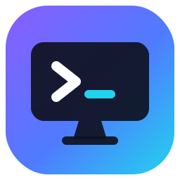
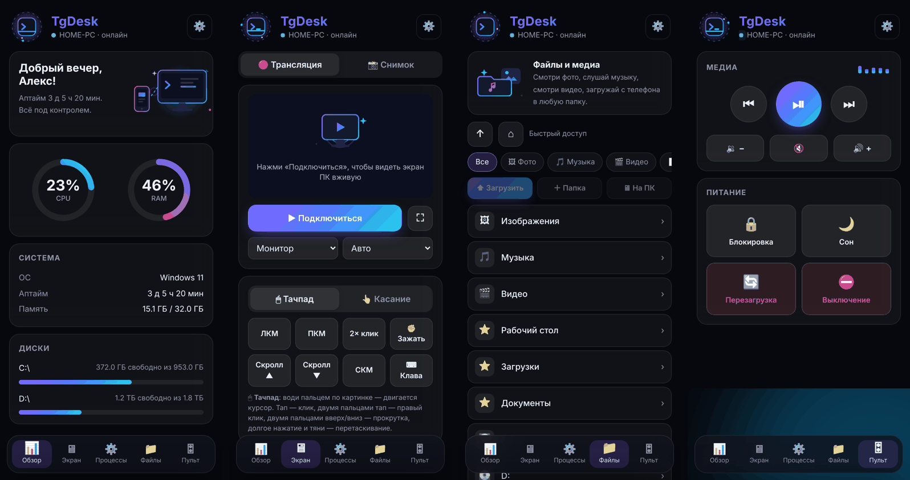

<p align="center">
  
</p>

<h1 align="center">TgDesk</h1>

<p align="center">
  <b>Управляй своим Windows-ПК прямо из Telegram</b><br>
  <sub>Экран вживую · мышь и клавиатура · файлы · буфер обмена · звук · питание</sub>
</p>

<p align="center">
  <a href="https://github.com/k1llerov/tgdesk/releases/latest"></a>&nbsp;
  <a href="https://github.com/k1llerov/tgdesk/actions/workflows/build.yml"></a>&nbsp;
  <a href="LICENSE"></a>&nbsp;
  <a href="README.en.md"></a>
</p>

<br>

<p align="center">
  
</p>

<br>

TgDesk — это **твой собственный Telegram-бот** и Mini App, работающие на твоём компьютере. Всё управление идёт через Telegram, а бот, веб-сервер и журнал живут прямо на ПК. Единственные внешние сервисы — Telegram и туннель Cloudflare.

---

## Возможности

<table>
<tr>
<td width="50%">

### 🖥 Экран вживую
Смотри экран ПК на телефоне в реальном времени. Тачпад или прямое касание, щипок для увеличения, полноэкранный режим. Качество подстраивается под скорость сети автоматически.

### 🖱 Мышь и клавиатура
Клики, прокрутка, перетаскивание, ввод текста на любом языке, Ctrl/Alt/Win и горячие клавиши — всё как сидишь за компьютером.

### 📋 Буфер обмена
Текст с телефона в буфер ПК и обратно. Во вкладке «Пульт» или командой `/clip`. В журнал пишется только длина текста, не содержимое.

</td>
<td width="50%">

### 📁 Файлы
Быстрый доступ ко всем дискам. Просмотр фото, музыка и видео прямо в приложении. Загрузка с телефона в любую папку (частями, с докачкой). Отправка файлов в чат.

### ⚙️ Процессы
Список самых тяжёлых процессов. Завершение в одно касание.

### 🎛 Пульт
Громкость и медиакнопки, блокировка, сон, перезагрузка, выключение — всё с подтверждением опасных действий.

</td>
</tr>
</table>

### А ещё

- 🤖 **Бот в чате** — статус, скриншот, процессы, медиа, питание — без открытия Mini App. Фото, видео и музыка, отправленные боту, раскладываются по папкам на ПК.
- 👥 **Несколько пользователей** с раздельными правами: кому-то только экран, кому-то всё.
- 🖥 **Приложение на ПК** — мастер настройки, кто смотрит экран прямо сейчас (с кнопкой «Отключить»), журнал доступа, управление пользователями и функциями, трей.
- 🌐 **Русский и английский** — везде: в приложении, боте и Mini App.
- 🔄 **Автообновление** — новая версия ставится сама (никогда во время трансляции). Устанавливаются только релизы, **подписанные ключом автора** (ECDSA P-256), — поддельное обновление не пройдёт. Выключается в настройках.

---

## 🛡 Безопасность и честное использование

TgDesk создан для управления **своим** компьютером (или компьютером, владелец которого знает и согласен). Часть защит отключить **нельзя**:

| | Защита | Описание |
|---|---|---|
| 🔴 | **Плашка трансляции** | Всегда видна на ПК, пока кто-то смотрит экран. Скрыть невозможно. |
| 👁 | **Журнал доступа** | Каждое действие записывается: кто, когда, IP, устройство. |
| 🔐 | **Только добавленные** | Бот не отвечает незнакомцам. Добавить можно только с самого ПК: одноразовый код, 5 минут, сгорает после 5 ошибок. |
| ✍️ | **Подпись Telegram** | Каждый запрос Mini App проверяется. 8 ошибок с одного IP — блок на 15 минут. |
| 🗝 | **Шифрование токена** | Токен бота зашифрован Windows DPAPI — прочитает только твой пользователь Windows. |
| 🧱 | **Только localhost** | Журнал и API управления доступны только с самого ПК (`127.0.0.1`). |

> Подробнее — в [SECURITY.md](SECURITY.md).

---

## 🚀 Установка (5 минут)

### 1. Скачай и установи

Скачай **[TgDesk-Setup-x.y.z.exe](https://github.com/k1llerov/tgdesk/releases/latest)** со страницы релизов. Это один файл, всё уже внутри (включая .NET). **Права администратора не нужны.**

> [!NOTE]
> Установщик не подписан сертификатом — Windows SmartScreen может предупредить.
> Нажми «Подробнее» → «Выполнить в любом случае».
> Контрольные суммы — в `SHA256SUMS.txt` рядом с установщиком.

### 2. Создай бота

Откроется мастер настройки. Нажми **«Открыть @BotFather»**, отправь `/newbot`, придумай имя и адрес бота.

### 3. Вставь токен

Скопируй присланный BotFather токен и вставь его в мастер → **«Проверить и сохранить»**.

### 4. Привяжи себя

На экране появится **код привязки**. Нажми «Открыть в Telegram» или отправь боту `/pair 123456` — так ты станешь владельцем.

### 5. Готово!

Выбери, какие функции разрешены. В чате с ботом внизу появится кнопка **TgDesk** — она открывает панель.

> [!IMPORTANT]
> Компьютер должен быть включён и не спать:
> *Параметры → Система → Питание → Сон → «Никогда»*.

---

## 👥 Пользователи и права

В приложении на ПК открой **«Пользователи» → «Добавить пользователя»**:

1. Выбери **«Полный доступ»** или отдельные функции:
   - 🖥 Экран
   - 🖱 Мышь и клавиатура
   - 📁 Файлы
   - ⚙️ Процессы
   - 🔊 Звук и медиа
   - 🔌 Питание

2. Нажми **«Создать код»**.
3. Человек открывает ссылку или пишет боту `/pair <код>`.

Права можно поменять или забрать в любой момент — текущие трансляции этого пользователя сразу отключаются.

> На странице **«Функции»** можно выключить функцию целиком — тогда она недоступна никому, даже владельцам.

---

## 🌐 Адрес Mini App

Telegram открывает Mini App только по HTTPS, поэтому TgDesk поднимает туннель.

| Режим | Что нужно | Особенности |
|:---|:---|:---|
| **Quick Tunnel** *(по умолчанию)* | Ничего | Бесплатно, без регистрации. Адрес меняется при каждом запуске — бот обновляет кнопку сам. `cloudflared` скачивается с GitHub Cloudflare, SHA-256 сверяется. |
| **Cloudflare Tunnel** | Аккаунт Cloudflare + домен | Постоянный адрес. Создай туннель в Zero Trust → Networks → Tunnels, направь на `http://127.0.0.1:8765`, вставь токен и адрес. |
| **Свой адрес** | Свой HTTPS-прокси | Любой HTTPS, который ты направил на `http://127.0.0.1:8765` этого ПК. |

---

## 🗂 Где что лежит

```
📦 %LOCALAPPDATA%\Programs\TgDesk\         ← программа
│  ├── TgDesk.exe                           ← приложение на ПК
│  ├── bot\TgDeskBot.exe                    ← бот и веб-сервер
│  ├── webapp\                              ← Mini App (HTML/JS)
│  └── Uninstall TgDesk.exe                 ← деинсталлятор
│
📂 %APPDATA%\TgDesk\                        ← данные
│  ├── config.json                          ← настройки (токены зашифрованы DPAPI)
│  ├── users.json                           ← пользователи и права
│  ├── access_log.jsonl                     ← журнал доступа
│  ├── tgdesk.log                           ← технический журнал
│  └── bin\cloudflared.exe                  ← туннель (скачивается при первом запуске)
│
🖼 Изображения\TgDesk\                      ← фото, присланные боту
🎵 Музыка\TgDesk\                           ← музыка
🎬 Видео\TgDesk\                            ← видео
📥 Загрузки\TgDesk\                         ← прочие файлы
```

**Портативный режим**: распакуй `TgDesk-x.y.z-portable.zip` — файл `portable.txt` рядом с `TgDesk.exe` заставляет хранить всё в папке `data` рядом.

**Удаление**: через «Параметры → Приложения», из «О программе → Удалить TgDesk» или запустив `Uninstall TgDesk.exe`.
Тихий режим: `/S`, с удалением данных: `/S /purge`.

---

## 🏗 Как это устроено

```
                      ┌─────────────────────────────────────────────────────────┐
                      │                     Твой ПК (Windows)                   │
                      │                                                         │
 📱 Telegram ═══HTTPS═══► Cloudflare ──► :8765  TgDeskBot.exe  (C# / .NET 10)  │
                      │       Tunnel       │  ├─ Telegram-бот (long polling)     │
                      │                    │  ├─ Mini App + WebSocket трансляции │
                      │                    │  ├─ :8766  журнал (localhost)       │
                      │                    │  └─ :8767  API управления (localhost│
                      │                    │             + control.token)        │
                      │                    │                 ▲                   │
                      │                    │    TgDesk.exe  (C++ / Win32 + GDI+)│
                      │                    │    окно · трей · мастер настройки  │
                      └────────────────────┴────────────────────────────────────┘
```

| Папка | Описание |
|:---|:---|
| `bot/` | Бот, веб-сервер, захват экрана, ввод, туннель (C# / ASP.NET Core) |
| `app/` | Приложение для ПК без зависимостей, ~1 МБ (C++17, Win32, GDI+) |
| `webapp/` | Mini App и страница журнала (HTML/JS без сборки) |
| `installer/` | Установщик и деинсталлятор (C++, GDI+, сжатие LZMS) + упаковщик |
| `scripts/` | Скрипты сборки и переводов |
| `tests/` | Тесты |

---

## 🔨 Сборка из исходников

**Необходимо:**
- [.NET 10 SDK](https://dotnet.microsoft.com/) (или локальный в `.tools\dotnet`)
- [MinGW-w64 g++](https://winlibs.com/) (`winget install BrechtSanders.WinLibs.POSIX.UCRT`)
- [Python 3](https://python.org/)

```powershell
git clone https://github.com/k1llerov/tgdesk
cd tgdesk
```

```powershell
dotnet test tests/TgDesk.Tests/TgDesk.Tests.csproj
```

```powershell
.\scripts\build.ps1 -Installer -Portable
```

Результат — в `dist\`. Каждый тег `v*` собирается в GitHub Actions и выкладывается черновиком релиза вместе с `SHA256SUMS.txt`.

---

## 🌍 Перевод

Тексты пишутся по-русски прямо в коде, английские переводы — в `i18n/*.en.json`. После изменения текстов:

```powershell
python scripts/i18n.py
```

Подробнее — в [docs/TRANSLATING.md](docs/TRANSLATING.md).

---

## ❓ Частые вопросы

<details>
<summary><b>Бот не подключается</b></summary>

Если Telegram в твоей сети заблокирован, нужен VPN на ПК. Состояние видно на странице «Обзор», подробности — в «Журнал → Системный лог».
</details>

<details>
<summary><b>«409 Conflict» в техническом журнале</b></summary>

Этот токен уже использует другая программа. Каждому ПК нужен свой бот.
</details>

<details>
<summary><b>Не работает ввод в некоторых окнах</b></summary>

Windows не даёт управлять окнами, запущенными от администратора, и экраном блокировки.
</details>

<details>
<summary><b>Кнопка TgDesk не появилась</b></summary>

Отправь боту `/start` — придёт кнопка «Открыть TgDesk».
</details>

<details>
<summary><b>Windows SmartScreen блокирует установщик</b></summary>

Установщик не подписан сертификатом. Нажми «Подробнее» → «Выполнить в любом случае». Проверь контрольную сумму в `SHA256SUMS.txt`.
</details>

---

## 📄 Лицензия и автор

Автор — **k1llerov™**

Лицензия — [MIT](LICENSE). Используй честно: только на своих компьютерах или с согласия их владельцев.

---

<p align="center">
  <sub>Сделано с ❤️ by <b>k1llerov™</b></sub><br>
  <sub>© 2026 · MIT License</sub>
</p>
